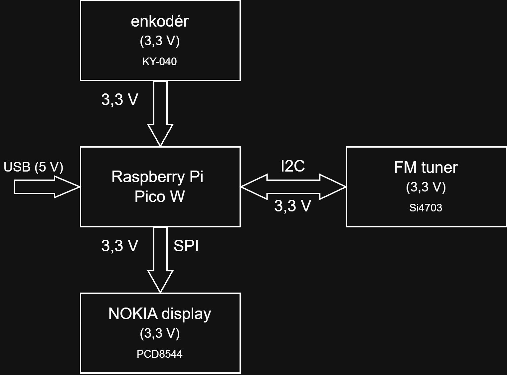
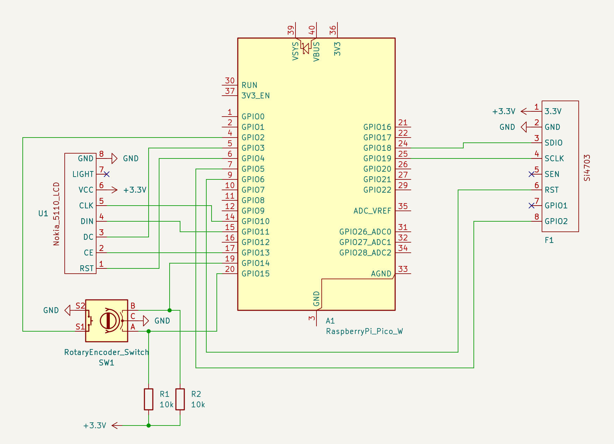

# DE2_Projekt-FM_Receiver
Jednoduchý přijímač FM stanic řízený mikrokontrolérem RPi Pico W

## Členové týmu
- Marek Hostášek - SPI Displej 
- Michael Jurča - FM Tuner
- Denis Kaňovský - Integrace rotačního enkodéru

## Obsah
- [Základní popis fungování](#Základní-popis-fungování)
- [Blokové schéma](#Blokové-schéma)
- [Schéma](#Schéma)
- [I/O sekce](#IO-sekce)
- [Použité zdroje](#Použité-zdroje)

## Blokové schéma

## Schéma

## Hardware

| Součástka | Model | Odkazy |
|:-----:|-----| :---: |
| Mikrokontrolér | Raspberry Pi Pico W | [Odkaz na datasheet](https://pip-assets.raspberrypi.com/categories/686-raspberry-pi-pico-w/documents/RP-008312-DS-3-pico-w-datasheet.pdf) |
| Rotační enkodér | Okystar KY-040 | [Odkaz na datasheet](https://okystar.com/wp-content/uploads/2017/08/OKY3431.pdf) |
| FM tuner | Si4703 | [Odkaz na datasheet](https://cdn.sparkfun.com/assets/learn_tutorials/2/7/4/Si4703_datasheet.pdf) |
| LCD displej | Displej z Nokia 5110 | [Odkaz na datasheet řadiče PCD8544](https://cdn.sparkfun.com/assets/b/1/b/e/f/Nokia5110.pdf) |

## Základní popis fungování

## I/O sekce

## Použité zdroje
| Odkaz |
|:-----:|
| [Arduino Rotary Encoder User Manual](https://cdn.shopify.com/s/files/1/0672/9409/files/ky-040-rotary-encoder-datasheet-and-tutorial.pdf) |
| [Claude (AI)](https://claude.ai/) |
| [Raspberry Pi Pico Pinout](https://pico.pinout.xyz/) |
